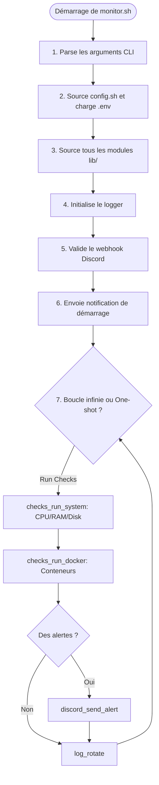
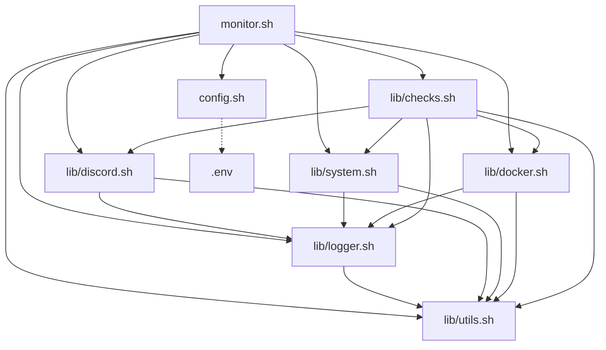

# 🏗️ Architecture de NodeSentinel

Ce document décrit en détail l'architecture technique du projet **NodeSentinel**, ses choix de conception et son fonctionnement interne.

## 🌟 Vue d'ensemble

NodeSentinel est un outil de surveillance système Linux et Docker conçu avec une philosophie simple : **légèreté, modularité et absence de dépendances lourdes**. Entièrement écrit en **Bash pur**, il vise à fournir une surveillance fiable sans consommer de ressources significatives, en notifiant les administrateurs directement via des webhooks Discord.

## 📂 Arborescence du projet

Voici la structure complète du projet :

```text
NodeSentinel/
├── monitor.sh           # Script principal (point d'entrée)
├── config.sh            # Chargement de la configuration (.env et valeurs par défaut)
├── install.sh           # Script d'installation (création de l'utilisateur, systemd)
├── uninstall.sh         # Script de désinstallation et nettoyage
├── .env.example         # Template de configuration
├── docs/                # Documentation du projet
│   ├── ARCHITECTURE.md  # Ce fichier
│   ├── API_REFERENCE.md # Référence des fonctions
│   ├── CONTRIBUTING.md  # Guide de contribution
│   ├── TROUBLESHOOTING.md # Guide de dépannage
│   └── todo.md          # Liste des tâches
└── lib/                 # Modules Bash
    ├── checks.sh        # Orchestration des vérifications
    ├── discord.sh       # Intégration et API Discord
    ├── docker.sh        # Sondes Docker
    ├── logger.sh        # Système de journalisation
    ├── system.sh        # Sondes système (CPU, RAM, Disque)
    └── utils.sh         # Fonctions utilitaires générales
```

## 🔄 Diagramme de flux (`monitor.sh`)

Voici le cycle de vie d'une exécution typique du script principal :



## 🧩 Architecture Modulaire

Pour pallier les limitations de Bash concernant l'organisation du code, NodeSentinel utilise un pattern de modularité strict :

1. **Guard anti-double-sourcing** : Chaque fichier module empêche sa réinclusion multiple.
2. **Préfixe de fonction** : Toutes les fonctions sont préfixées par le nom de leur module (ex: `logger_info`, `system_get_cpu`).
3. **Dépendances explicites** : Les modules sourcent leurs propres dépendances.

### Diagramme de dépendances



## 🚨 Système d'alertes

Le système d'alertes est conçu pour formater des données Bash vers un payload JSON compatible avec l'API Discord. 

- **Champs Discord (Embeds)** : Les alertes sont formatées sous forme d'Embeds Discord. Le script rassemble plusieurs champs au format JSON (nom, valeur) puis les fusionne en un seul appel API pour éviter le rate-limiting.
- **Niveaux de sévérité** :
  - **OK (0)** : Vert (`3066993`) - Retour à la normale.
  - **WARNING (1)** : Jaune (`15105570`) - Seuil d'avertissement dépassé.
  - **CRITICAL (2)** : Rouge (`15158332`) - Seuil critique dépassé ou arrêt de service.
- **Fusion des rapports** : La fonction `checks_run_all` consolide les statuts des sondes système et Docker, conserve le niveau de sévérité le plus haut et envoie un seul payload groupé à Discord.

## ⚙️ Intégration systemd

Contrairement aux outils basés sur `cron`, NodeSentinel privilégie systemd via un modèle **Timer + Oneshot** :
- **Avantages** : Les exécutions sont journalisées dans `journald`, la gestion des dépendances est native (ex: attendre le réseau), et il n'y a pas de risque de chevauchement si une exécution est anormalement longue.
- **nodesentinel.service** : Déclare l'exécution du script en mode `Type=oneshot`.
- **nodesentinel.timer** : Planifie l'exécution régulière et s'assure du rattrapage des exécutions manquées (`Persistent=true`).

## 📜 Conventions de code

Pour garantir la maintenabilité, toutes les contributions doivent respecter ces conventions :

- **Shebang strict** : `#!/usr/bin/env bash`
- **Sécurité** : `set -euo pipefail` en haut de chaque script exécutable pour arrêter le script en cas d'erreur ou de variable non définie.
- **Nommage des fonctions** : `module_action_verb()` (en anglais).
- **Variables globales** : `UPPERCASE_SNAKE_CASE`.
- **Variables locales** : Toujours déclarées avec `local lowercase_snake_case`.
- **Commentaires** : En **français**, clairs et professionnels.
- **Guard de module** : 
  ```bash
  [[ -n "${_NOMMODULE_LOADED:-}" ]] && return 0; _NOMMODULE_LOADED=1
  ```
